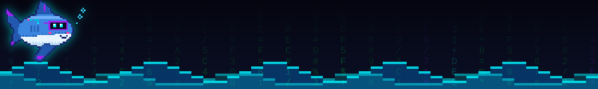

<div align="center">



<a href="https://github.com/blazeeternum"></a>

</div>



## 🦈 About Me

```text
┌──[ blaze@digital-ocean ]─[~]
└─$ cat about.txt

  name        : Lau Zen Hao
  alias       : Blaze Eternum
  location    : Malaysia
  studying    : B.IT (Cyber Security) with Honours
  institution : NEW ERA University College (since 2026)
  aiming for  : Incident Response Specialist
                Security Researcher
  mindset     : Builder → Defender
```

> *"To protect a system, you must first understand how it is built from the ground up."*

I build things (games, 3D scenes, websites, small tools) to understand how systems work from the inside. Then I use that understanding to defend them. That is the **Builder → Defender** path.

**What pulls me in:** cybersecurity · game development · 3D modeling · video editing · IT support · technology exploration · PC gaming


## 🧰 Tech Arsenal

**Programming**


**Tools**


**Currently learning**


<sub>I'm a student, so most of this stack is still growing. I'd rather show what I'm learning than overclaim.</sub>


## 🚀 Featured Projects

<table>
<tr><td>


A **2D action game** made at **Global Game Jam 2026** by team **META:GEN** (9 people).

- **My roles:** UI Designer · VFX Artist · Animator · Video Editor
- **Built with:** Unity · C# · Blender · 剪映

<a href="https://metagenteyben.itch.io/the-mask-guardian"></a>
<a href="https://www.youtube.com/watch?v=eMAPclollZ8"></a>

</td></tr>
</table>

<table>
<tr><td>


A **progressive VR exposure tool** designed to help people work through social anxiety and build confidence in public speaking. Built by team **META:GEN**.

🏆 **Top 3 in the VR Category**, MYVERSE Malaysia Creative Technology Competition 2026

- **My role:** Artist & Creative Designer
- **What I made:** 3D modeling · scene assets · environment design · level art · animation · SFX and VFX
- **Built with:** Unity · C# · Blender · 剪映

<a href="https://www.youtube.com/watch?v=Lp8jquOtJiI"></a>

</td></tr>
</table>

<table>
<tr><td>


**BlazeEternum File Secure Encryptor** is a personal file-encryption project written in **Rust**. I use it to explore post-quantum cryptography and how modern encryption pieces fit together.


> ⚠️ A personal learning project. It has not been independently audited and makes no security guarantees, so please don't use it to protect anything critical.

<!-- Add a repo link badge here once the encryptor is public. -->

</td></tr>
</table>


## 🎓 Education Timeline

```text
 2026 → NOW   ◉  Bachelor in IT (Cyber Security)
                  with Honours
                  NEW ERA University College
 │
 2025 → 2026  ○  Foundation in Arts
 │
 2024         ○  SPM
```


## 📊 GitHub Stats

<div align="center">


<sub>Live cards from third-party services. If one is down, the rest of this page still works.</sub>

</div>


## 📡 Connect

<div align="center">

<a href="https://github.com/blazeeternum"></a>
<a href="https://www.linkedin.com/in/%EF%BC%88blaze%EF%BC%89lau-zen-hao-334884223/"></a>
<a href="mailto:zenhao007@gmail.com"></a>
<a href="https://www.youtube.com/@BlazeEternum"></a>
<a href="https://www.instagram.com/lauzenhao_blaze/"></a>
<a href="https://blazewebsite.dpdns.org/"></a>

</div>


<div align="center">

*"Every system has a weakness. Every weakness is an opportunity to learn."*



`SYSTEM ONLINE | SHARK MODE ACTIVE | ALWAYS EVOLVING`

</div>
