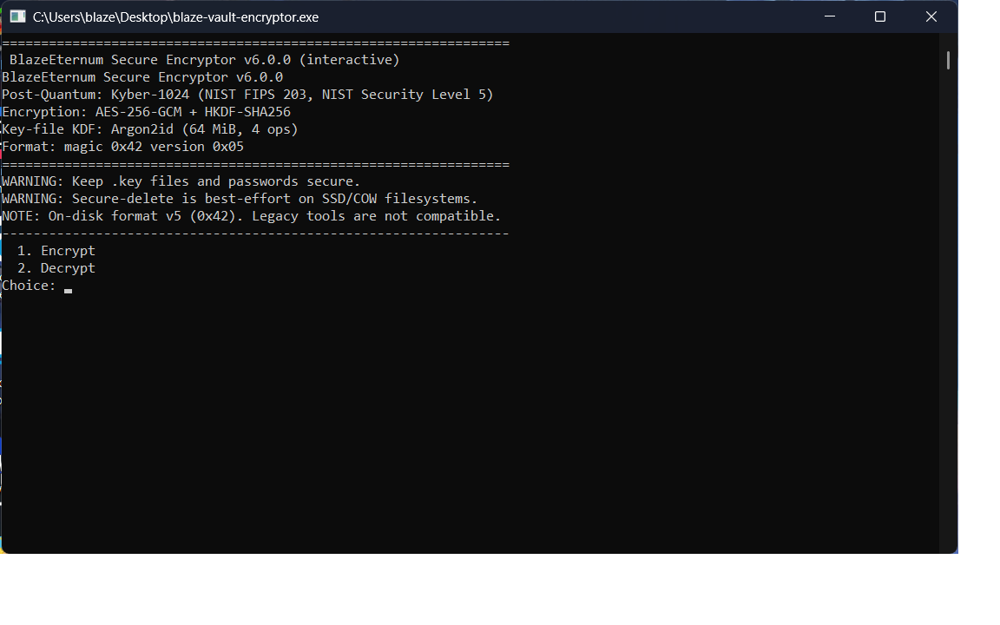
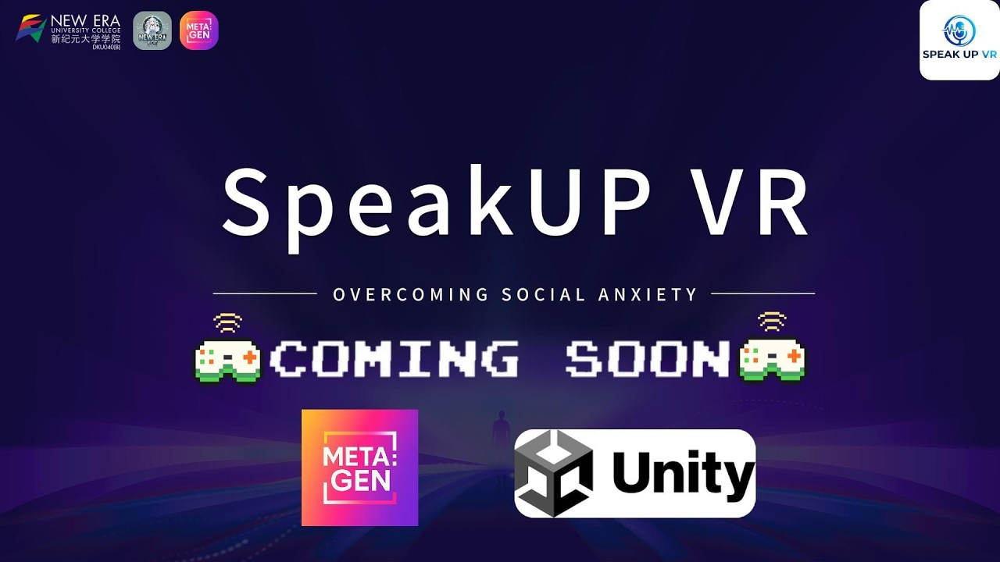

<div align="center">



<a href="https://github.com/blazeeternum">
  
</a>

<br/>

<a href="https://blazewebsite.dpdns.org/"></a>
<a href="https://www.youtube.com/@BlazeEternum"></a>
<a href="https://www.linkedin.com/in/zen-hao-lau-334884223/"></a>
<a href="https://www.instagram.com/lauzenhao_blaze/"></a>
<a href="mailto:zenhao007@gmail.com"></a>

<br/><br/>
<sub>🔍 Open to: <b>CTF teams</b> · <b>collaboration</b></sub>

</div>


## 🦈 `whoami`

```text
blaze@eternum:~$ whoami
> Lau Zen Hao  aka  Blaze Eternum

blaze@eternum:~$ cat about.txt
> 🎓 BIT (Cyber Security) with Honours @ New Era University College (2026 intake)
> 🎯 Goal      : Incident Response Specialist / Security Researcher
> 🛠️ Also into : game dev, 3D modeling, video editing
> 🏸 Offline   : badminton, bowling, PC games, tech news on YouTube

blaze@eternum:~$ echo $PHILOSOPHY
> "To protect a system, you must first understand how it is built from the ground up."
```

<div align="center">

**Builder → Defender** 🛡️ &nbsp;|&nbsp; *“与技术共同进化，守护数字世界的安全。”*

</div>


## 🧰 Tech Stack

<div align="center">

  
  
  
  
  
  
  
<br/>
  
  
  
  
  
  
<br/>
  
  
  

</div>


## 🚀 Featured Projects

<table>
  <tr>
    <td width="33%" valign="top">
      
      <h3>🔐 BlazeEternum Secure Encryptor v6.0.0</h3>
      <p>Post-quantum file encryption tool in <b>Rust</b>.<br/>
      <code>ML-KEM-1024 / Kyber (FIPS 203)</code> · <code>AES-256-GCM + HKDF-SHA256</code> · <code>Argon2id</code> key-file KDF.</p>
      <sub>Personal &amp; educational project · not independently audited</sub>
      <!-- TODO: add repo link, e.g. <a href="https://github.com/blazeeternum/YOUR-REPO">💻 Source</a> -->
    </td>
    <td width="33%" valign="top">
      
      <h3>🥽 SpeakUP VR</h3>
      <p>Progressive VR exposure tool for overcoming social anxiety and mastering public speaking.<br/>
      <b>My role:</b> 3D modeling, environment art, animation, SFX &amp; VFX.</p>
      <p>🥉 <b>Top 3, VR Category</b>, MYVERSE Malaysia Creative Technology Competition 2026</p>
      <a href="https://www.youtube.com/watch?v=Lp8jquOtJiI">▶ Trailer</a>
    </td>
    <td width="33%" valign="top">
      
      <h3>🎭 The Mask Guardian</h3>
      <p>2D action game: fight monsters with weapons and masks that grant unique buffs.<br/>
      <b>My role:</b> UI, VFX, animation, video editing (team of 9).</p>
      <p>🎮 Global Game Jam 2026 · META:GEN</p>
      <a href="https://www.youtube.com/watch?v=eMAPclollZ8">▶ Trailer</a> · <a href="https://metagenteyben.itch.io/the-mask-guardian">🕹️ Play on itch.io</a>
    </td>
  </tr>
</table>


## 🛡️ Security Focus

```text
blaze@eternum:~$ cat security_roadmap.txt
[>] Networking fundamentals  : TCP/IP, DNS, HTTP
[>] Log analysis             : Windows Event Logs, Linux logs
[>] Packet analysis          : Wireshark
[ ] Incident response        : lifecycle per NIST SP 800-61
[ ] Threat frameworks        : MITRE ATT&CK
[ ] Hands-on practice        : CTFs, TryHackMe, HackTheBox
[x] Applied cryptography     : built a post-quantum file encryptor (Rust)

legend: [x] done   [>] learning   [ ] planned
```
<!-- TODO: add your real certifications / CTF results here once you have them -->


## 🏆 Highlights

- 🥉 **Top 3 (VR)**, MYVERSE Malaysia Creative Technology Competition 2026, with Team META:GEN
- 🎮 Participant, **Global Game Jam 2026**: shipped a playable game under a hard deadline
- 🎓 Studying **Cyber Security** at New Era University College

<details>
<summary><b>📚 Currently learning</b></summary>
<br/>

`Networking` · `Log Analysis` · `Wireshark` · `Incident Response` · `MITRE ATT&CK` · `JavaScript DOM` · `Responsive Design` · `UI/UX Basics` · `CSS Animations` · `Unity` · `3D Modeling` · `Advanced Video Editing`

</details>


<details>
<summary><b>📊 GitHub Stats</b></summary>
<br/>

<div align="center">


</div>

</details>

<br/>


